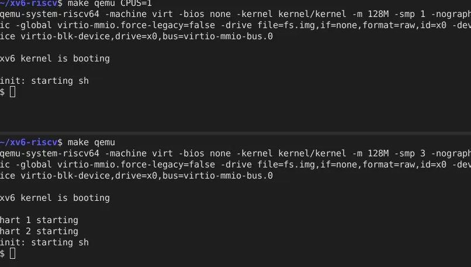
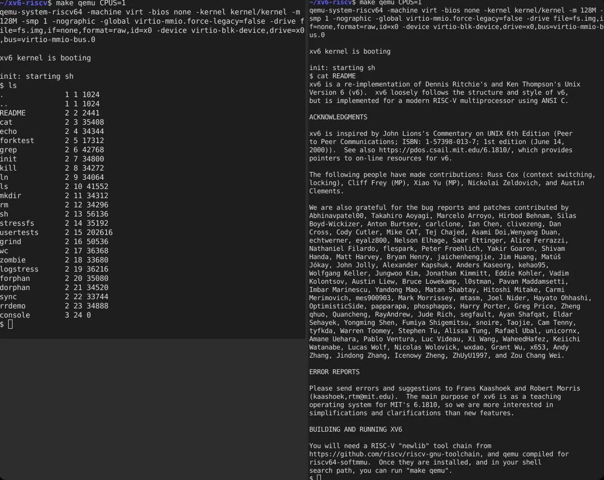
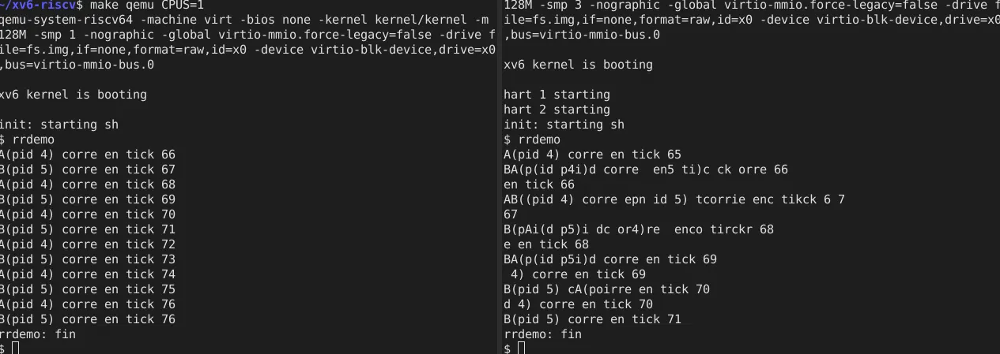

# Reporte: planificación en XV6 y análisis de MLFQ

**Curso:** Sistemas Operativos  
**Integrantes:** Joan Lorenzo Hinestroza Cantillo 2516995 · Juan Sebastian Duarte Quintero 2516473  
**Repositorio:** https://github.com/carlosk4/xv6-riscv  
**Base:** `mit-pdos/xv6-riscv`, commit `fa2ddcb7ca87a77af579380a6eafd5aff163b44f`

---

## Paso 1. Entorno y repositorio

Trabajamos en Windows con WSL2, sobre Ubuntu 24.04.1 LTS:

```console
$ uname -a
Linux DESKTOP-K4V821P 5.15.153.1-microsoft-standard-WSL2 #1 SMP Fri Mar 29 23:14:13 UTC 2024 x86_64 x86_64 x86_64 GNU/Linux
$ cat /etc/os-release | head -4
PRETTY_NAME="Ubuntu 24.04.1 LTS"
NAME="Ubuntu"
VERSION_ID="24.04"
VERSION="24.04.1 LTS (Noble Numbat)"
```

Para instalar las dependencias y compilar usamos:

```bash
sudo apt-get update
sudo apt-get install -y git build-essential gcc-riscv64-linux-gnu qemu-system-misc
git clone https://github.com/carlosk4/xv6-riscv.git && cd xv6-riscv
git checkout riscv
make
```

El fork parte del commit `fa2ddcb` de `mit-pdos/xv6-riscv`. Encima de ese commit está el nuestro, que agrega este reporte, las capturas, `user/rrdemo.c` y una línea en el `Makefile`:

```console
$ git log --oneline -n 2
b4bf75c reporte planificacion xv6
fa2ddcb usertests: bound the zero-length pipe read regression test
```

Versiones de las herramientas:

```console
$ riscv64-linux-gnu-gcc --version
riscv64-linux-gnu-gcc (Ubuntu 13.2.0-23ubuntu4) 13.2.0
$ qemu-system-riscv64 --version
QEMU emulator version 8.2.2 (Debian 1:8.2.2+ds-0ubuntu1.2)
```

Al compilar aparece la advertencia `kernel/kernel has a LOAD segment with RWX permissions`. Es un aviso del enlazador y no impide que XV6 arranque.

---

## Paso 2. Ejecución de XV6

### 2.1 Una sola CPU virtual

En el `Makefile`, `CPUS` tiene el valor 3 por defecto (`ifndef CPUS` / `CPUS := 3`) y se pasa a QEMU como `-smp $(CPUS)`. Como el valor solo se asigna si no viene definido, basta con darlo en la línea de comandos, sin modificar el archivo:

```console
$ make qemu CPUS=1
qemu-system-riscv64 -machine virt -bios none -kernel kernel/kernel -m 128M -smp 1 -nographic ...

xv6 kernel is booting

init: starting sh
$
```

Con las 3 CPUs por defecto, el arranque muestra además `hart 1 starting` y `hart 2 starting`; ese mensaje lo imprime cada CPU adicional en `kernel/main.c`. Con `CPUS=1` no aparece ninguno, lo que muestra que QEMU levantó una sola CPU.


*Captura 1: arriba, `make qemu CPUS=1` (`-smp 1`), sin mensajes de otras CPUs. Abajo, `make qemu` (`-smp 3`), donde aparecen `hart 1` y `hart 2`.*

### 2.2 Comandos `ls` y `cat`

Dentro de la shell de XV6 probamos `ls` y `cat README`:

```console
$ ls
.              1 1 1024
..             1 1 1024
README         2 2 2441
cat            2 3 35408
...
sh             2 13 56136
usertests      2 15 202616
rrdemo         2 23 34888
console        3 24 0
$ cat README
xv6 is a re-implementation of Dennis Ritchie's and Ken Thompson's Unix
Version 6 (v6).  xv6 loosely follows the structure and style of v6,
but is implemented for a modern RISC-V multiprocessor using ANSI C.
...
```


*Captura 2: `ls` lista cada archivo con su tipo (1 = directorio, 2 = archivo, 3 = dispositivo), su número de inodo y su tamaño. `cat README` muestra el contenido del archivo, así que el disco y el sistema de archivos funcionan. En la lista también está `rrdemo`, el programa que usamos en el Paso 3.*

---

## Paso 3. El planificador original

### i. Algoritmo: Round Robin apropiativo

XV6 usa Round Robin con expropiación. Cada 0,1 segundos aproximadamente llega una interrupción del temporizador (un *tick*) y el proceso que está corriendo cede la CPU con `yield()`, así que el *quantum* es de 1 tick. No hay prioridades: `scheduler()` recorre la tabla de procesos `proc[]` en orden y ejecuta el primero que esté `RUNNABLE`.

Para comprobarlo escribimos `user/rrdemo.c`. El programa crea dos hijos, A y B, que solo hacen cálculos en un bucle. Cada vez que un hijo nota que el contador de ticks cambió, imprime su PID y el tick, es decir, imprime cuando vuelve a tener la CPU. Con `CPUS=1`, y como primer comando después de arrancar, obtuvimos:

```console
$ rrdemo
A(pid 4) corre en tick 66
B(pid 5) corre en tick 67
A(pid 4) corre en tick 68
B(pid 5) corre en tick 69
A(pid 4) corre en tick 70
B(pid 5) corre en tick 71
A(pid 4) corre en tick 72
B(pid 5) corre en tick 73
A(pid 4) corre en tick 74
B(pid 5) corre en tick 75
A(pid 4) corre en tick 76
B(pid 5) corre en tick 76
rrdemo: fin
```

A y B se turnan un tick cada uno, que es lo esperado en Round Robin. Los PID son 4 y 5 porque `init` y `sh` ya existían y `rrdemo` fue el pid 3.

En la última línea los dos aparecen en el tick 76. Nuestra explicación es que A termina su trabajo, llama a `exit()` y deja la CPU antes de que llegue la siguiente interrupción, así que B alcanza a correr en ese mismo tick. Un proceso no solo pierde la CPU por el reloj; también la deja cuando termina o cuando se bloquea.

Con `CPUS=3` los dos hijos corrieron al mismo tiempo en CPUs distintas y la salida se mezcló en la consola (por ejemplo `BA(p(id p4i)d corre en5 ti)c ck orre 66`). Por eso fue necesario usar una sola CPU para ver la alternancia.


*Captura 3: a la izquierda, con `CPUS=1`, A y B se alternan tick a tick. A la derecha, con `CPUS=3`, corren en paralelo y la salida se mezcla.*

### ii. Dónde se elige el siguiente proceso

La selección se hace en la función `scheduler()` del archivo `kernel/proc.c`. Cada CPU ejecuta este bucle infinito:

```c
for (;;) {
  intr_on();
  intr_off();
  int found = 0;
  for (p = proc; p < &proc[NPROC]; p++) {
    acquire(&p->lock);
    if (p->state == RUNNABLE) {
      p->state = RUNNING;
      c->proc = p;
      swtch(&c->context, &p->context);   // entrega la CPU al proceso
      mycpu()->intena = 0;
      c->proc = 0;                       // el proceso devolvió la CPU
      found = 1;
    }
    release(&p->lock);
  }
  if (found == 0)
    asm volatile("wfi");                 // nada listo: espera una interrupción
}
```

El `for` interno recorre la tabla en orden y, al terminar, vuelve a empezar desde el principio; eso es lo que hace que la política sea Round Robin. Antes de revisar el estado de un proceso se toma su `p->lock`. La función `swtch` (en `kernel/swtch.S`) hace el cambio de contexto: guarda los registros del planificador y carga los del proceso elegido.

### iii. Estados y eventos

Los estados de un proceso están en `enum procstate` de `kernel/proc.h`. Las transiciones son estas:

```
UNUSED → USED (allocproc) → RUNNABLE (kfork) ⇄ RUNNING (scheduler / yield)
                                 ▲               │ sleep()
                                 └── wakeup() ── SLEEPING
RUNNING → ZOMBIE (kexit) → UNUSED (wait → freeproc)
```

El proceso que está en la CPU está en `RUNNING`, y el planificador solo elige procesos en `RUNNABLE`. Un proceso nunca llama directamente a `scheduler()`. Cambia su propio estado y llama a `sched()`, que con `swtch` vuelve al planificador; luego el planificador hace otro `swtch` hacia el siguiente proceso. Por eso un cambio de un proceso a otro pasa siempre por el planificador.

Los eventos que hacen ceder o recuperar la CPU son:

| Evento | Código | Cambio de estado |
| --- | --- | --- |
| Interrupción del reloj | `usertrap()` y `kerneltrap()` en `kernel/trap.c` llaman a `yield()` cuando `which_dev == 2` | RUNNING → RUNNABLE |
| Esperar algo (I/O, `pause`, pipe) | `sleep()` en `kernel/proc.c`: `p->state = SLEEPING; sched();` | RUNNING → SLEEPING |
| Termina la espera | `wakeup()`: si el proceso estaba `SLEEPING`, lo pasa a `RUNNABLE` | SLEEPING → RUNNABLE |
| Proceso nuevo | `kfork()` lo deja en `RUNNABLE` | USED → RUNNABLE |
| Terminar | `kexit()`: lo marca `ZOMBIE` y llama a `sched()` | RUNNING → ZOMBIE |

La función `yield()` muestra el patrón completo: cambia el estado y le devuelve la CPU al planificador.

```c
void yield(void) {
  struct proc *p = myproc();
  acquire(&p->lock);
  p->state = RUNNABLE;
  sched();
  release(&p->lock);
}
```

Una diferencia con el libro: en esta versión, `sleep` se divide en dos funciones, `sleep_prepare()` y `sleep()`. También observamos en `clockintr()` que solo la CPU 0 incrementa la variable global `ticks`.

### iv. Cómo entra este código al kernel

En el `Makefile`, `OBJS` lista todos los archivos objeto del kernel, entre ellos `proc.o`, `swtch.o` y `trap.o`. Cada `.c` se compila por separado y luego todos se enlazan en un único ejecutable, `kernel/kernel`:

```make
$(LD) $(LDFLAGS) -T $K/kernel.ld -o $K/kernel $(OBJS)
```

El script de enlace `kernel/kernel.ld` decide dónde queda cada parte en memoria. El código (`.text`) empieza en la dirección `0x80000000`, con `_entry` (de `entry.S`) al inicio, porque ahí salta QEMU al arrancar. Después van los datos. El planificador no es un programa aparte: queda dentro del mismo binario del kernel. Lo comprobamos así:

```console
$ riscv64-linux-gnu-readelf -h kernel/kernel | grep Entry
  Entry point address:               0x80000000
$ grep -wE "_entry|scheduler|yield|swtch|usertrap|etext|proc" kernel/kernel.sym | sort
0000000080000000 _entry
0000000080001d4c scheduler
0000000080001eba yield
00000000800023b6 swtch
0000000080002598 usertrap
0000000080007000 etext
0000000080012748 proc
```

`scheduler`, `yield` y `swtch` tienen direcciones menores que `etext`, que marca el final del código, así que están en la sección de código del kernel. La tabla `proc` queda después, en la zona de datos.

---

## Paso 4. MLFQ en XV6

### 4.1 Reglas de MLFQ

**Descripción inicial, escrita antes de usar la IA.** MLFQ usa varias colas con distintas prioridades y Round Robin dentro de cada cola. Todo proceso nuevo entra en la cola más alta; si gasta su *quantum*, baja de nivel, y si suelta la CPU antes (por ejemplo, por I/O), se queda donde está. Cada cierto tiempo todos los procesos vuelven a subir.

Dudas que teníamos:

- ¿El *boost* sube a todos los procesos?
- Si un proceso se duerme por I/O, ¿se le reinicia el tiempo que lleva?
- ¿Cómo se evita que un proceso haga I/O justo antes de que se le acabe el turno para no bajar?
- ¿Qué tan preciso es medir con ticks de 100 ms?

**Descripción revisada, después de leer OSTEP (cap. 8) y de la conversación con la IA:**

- **R1:** si la prioridad de A es mayor que la de B, se ejecuta A.
- **R2:** si A y B tienen la misma prioridad, se turnan en Round Robin con el *quantum* de esa cola.
- **R3:** todo proceso nuevo entra en la cola de mayor prioridad.
- **R4:** cuando un proceso gasta el tiempo total asignado a su nivel, baja una cola, sin importar cuántas veces haya cedido la CPU antes.
- **R5:** cada cierto periodo *S*, todos los procesos vuelven a la cola más alta (*priority boost*).

Con esto resolvimos las dudas. El *boost* sí sube a todos los procesos y sirve para que los procesos largos no se queden sin CPU para siempre (inanición). El tiempo usado en un nivel no se reinicia al hacer I/O; si se reiniciara, un proceso podría usar casi todo su turno, hacer una I/O corta y quedarse arriba indefinidamente. La pregunta de la precisión quedó abierta y la retomamos en las decisiones pendientes.

### 4.2 Análisis de incorporación a XV6

#### Prompt utilizado

```text
Actúa como tutor socrático de una pareja de estudiantes de cuarto semestre de Ingeniería de Sistemas. Conocemos C++ y hemos comenzado a explorar XV6 para RISC-V.

Queremos identificar y justificar qué se necesitaría para incorporar MLFQ a XV6. En esta entrega no vamos a implementarlo.

Nuestra descripción inicial del algoritmo, escrita antes de esta conversación:
MLFQ tiene varias colas con distinta prioridad y usa RR dentro de cada cola. Los procesos nuevos entran arriba; si gastan su quantum bajan de cola y si ceden la CPU antes (I/O) se mantienen en su cola. Cada cierto tiempo todos suben. Dudas: ¿el boost sube a todos? ¿Al dormir se reinicia el quantum? ¿Cómo evitar que alguien haga I/O justo antes de agotar su tiempo para no bajar? ¿Cómo medir bien con ticks de 100 ms?

Lo que averiguamos del planificador original y de su incorporación al sistema compilado:
XV6 usa RR apropiativo con quantum de 1 tick. scheduler() en kernel/proc.c recorre proc[] y ejecuta el primer RUNNABLE. usertrap() y kerneltrap() en kernel/trap.c llaman a yield() en cada interrupción de reloj. sleep_prepare()/sleep(), wakeup() y yield() cambian el estado y pasan por sched() y swtch.S. struct proc (kernel/proc.h) no tiene campos de prioridad ni contabilidad de CPU, y todo se enlaza estáticamente en kernel/kernel según kernel/kernel.ld.

Reglas de interacción:

1. Formula una sola pregunta principal por turno y espera nuestra respuesta. No presentes una lista completa de cambios ni una arquitectura resuelta.
2. Empieza examinando nuestra descripción de MLFQ. Ayúdanos a detectar reglas ambiguas, ausentes o contradictorias. No sustituyas nuestra descripción por una versión terminada ni elijas silenciosamente una variante del algoritmo.
3. Pídenos que propongamos y justifiquemos las decisiones que faltan. Después, ayúdanos a comprobarlas con ejemplos pequeños de procesos y decisiones de planificación que nosotros debamos resolver.
4. Guíanos para relacionar cada regla con XV6. Antes de sugerir una modificación, pregúntanos qué comportamiento necesitamos y qué evidencia del código respalda nuestra propuesta.
5. No supongas que tienes acceso a nuestro repositorio. Pide los fragmentos necesarios y distingue lo observado de lo que todavía sea una hipótesis. No inventes archivos, funciones o comportamientos de nuestra versión.
6. No entregues código de implementación, parches, una lista cerrada de archivos por modificar ni pseudocódigo que resuelva el planificador. Revisa nuestras propuestas y señala problemas mediante preguntas y pistas graduales. Puedes explicar conceptos previos con ejemplos mínimos.
7. Si nos bloqueamos, reduce la dificultad de la pregunta y ofrece una pista concreta. Si pedimos la solución directa, conserva el modo socrático.

El objetivo es que nosotros logremos:

A. Redactar una descripción revisada y coherente de la variante de MLFQ considerada.
B. Explicar qué cambios necesitaría XV6 para soportarla, indicando para cada uno su propósito, su relación con las reglas y la evidencia del código que lo justifica.
C. Proponer escenarios para comprobar una futura implementación del algoritmo MLFQ en el sistema operativo XV6. Pídenos que expliquemos qué procesos participarían, qué harían, qué regla comprobaríamos y qué comportamiento esperaríamos observar. No nos entregues los escenarios resueltos. En esta tarea solo los describiremos; no vamos a programarlos ni ejecutarlos.

Mantén el análisis dentro del alcance de una propuesta: no necesitamos implementar MLFQ ni construir un selector de planificadores. Ayúdanos a registrar las cuestiones que queden pendientes de investigación.

Al finalizar, pídenos que redactemos nuestras conclusiones. Comprueba su consistencia mediante una última pregunta aplicada a un caso concreto, sin escribir por nosotros el reporte.

Comienza con una pregunta que permita comprobar cómo entendemos una regla de nuestra descripción inicial de MLFQ.
```

#### Propuesta de cambios en XV6

Tomamos como ejemplo 3 colas (0 = alta, 1 = media, 2 = baja), con *quantum* de 1, 2 y 4 ticks; tiempo total por nivel de 2 ticks en la cola 0, 4 en la cola 1 y sin límite en la cola 2; y un *boost* cada 50 ticks. Son valores de partida para poder razonar con ejemplos, no valores definitivos.

**C1. Parámetros en `kernel/param.h`.** Definir ahí el número de colas, el *quantum* y el tiempo total de cada nivel, y el periodo del *boost*. Así quedan en un solo lugar y es fácil cambiarlos para probar.

**C2. Nuevos campos en `struct proc` (`kernel/proc.h`).** Hoy XV6 no guarda nada sobre el historial de un proceso, y MLFQ lo necesita. Proponemos agregar:

- `level`: en qué cola está (R1).
- `used`: cuánto tiempo lleva gastado en ese nivel (R4).
- `slice`: cuánto lleva de su turno actual (R2).
- Un número de llegada, para saber quién entró primero a la cola y respetar el orden de Round Robin (R2).

**C3. `allocproc()` en `kernel/proc.c`.** Poner `level = 0` y los contadores en cero al crear el proceso, para cumplir R3.

**C4. `usertrap()` y `kerneltrap()` en `kernel/trap.c`.** Hoy, en cada tick, ambos llaman a `yield()` sin más. Con MLFQ, en cada tick hay que sumarle tiempo al proceso que está corriendo y solo hacerlo ceder si se le acabó el turno (R2) o si gastó el tiempo de su nivel, en cuyo caso además baja de cola (R4). Tiene que estar en las dos funciones porque el tick puede llegar mientras el proceso corre código de usuario o mientras está dentro de una llamada al sistema.

**C5. `clockintr()` en `kernel/trap.c`.** Cada 50 ticks, devolver todos los procesos a la cola 0 y poner `used` en cero (R5). Es el mismo lugar donde hoy se incrementa `ticks`.

**C6. `scheduler()` en `kernel/proc.c`.** En lugar de tomar el primer `RUNNABLE` de la tabla, buscar el `RUNNABLE` de la cola más alta y, si hay varios, el que llegó primero (R1 y R2).

**C7. `yield()` y `wakeup()` en `kernel/proc.c`.** Cuando un proceso vuelve a `RUNNABLE`, actualizar su número de llegada para que quede al final de su cola (R2).

**C8. `sleep()` en `kernel/proc.c`.** Al dormirse, reiniciar `slice` pero no `used`. Así el proceso no puede borrar su tiempo acumulado haciendo I/O corta (R4).

**C9. `procdump()` en `kernel/proc.c`.** Mostrar `level` y `used` al presionar `Ctrl-P`. No es parte del algoritmo, pero permite ver en qué cola está cada proceso durante las pruebas.

#### Decisiones que necesitan más investigación

Estas decisiones no las pudimos cerrar solo con el análisis y habría que corroborarlas:

1. **Periodo del boost.** Si es muy corto, todos los procesos están casi siempre en la cola 0 y MLFQ se parece a Round Robin. Si es muy largo, los procesos de cálculo pueden esperar mucho. El valor de 50 ticks es un supuesto que habría que probar.
2. **Precisión al medir el tiempo.** Si solo contamos ticks completos, un proceso que corre 0,9 ticks y se duerme justo antes del reloj nunca suma nada en `used`, así que puede engañar a R4. Una opción sería leer el reloj del hardware al entrar y al salir de la CPU para medir el tiempo real. Habría que investigar si eso es confiable y cuánto cuesta.
3. **Tamaño del tick.** En XV6 un tick dura unos 100 ms. Un tick más corto mejoraría la respuesta, pero habría más interrupciones y cambiaría la duración de `pause(n)`.
4. **Qué pasa cuando despierta un proceso de alta prioridad.** Si un proceso de la cola 0 despierta mientras corre uno de la cola 2, puede esperar hasta el siguiente tick o expropiar de inmediato. Esperar es más simple, pero agrega hasta 100 ms de demora. No tenemos claro cómo se haría lo segundo en XV6.

Lo que sí decidimos: reiniciar `slice` al despertar pero conservar `used` (C8), y mantener la tabla `proc[]` en vez de crear listas separadas por cola, porque es más simple y alcanza para los 64 procesos de XV6.

#### Conclusiones

- Agregar MLFQ cambia cómo se elige el siguiente proceso (`scheduler()`), pero no cómo se hace el cambio de contexto (`sched()` y `swtch`).
- El reloj ya no obliga a cambiar de proceso en cada tick. Ahora sirve para medir cuánto ha usado cada proceso y decidir si debe ceder o bajar.
- Round Robin no recuerda nada de los procesos; MLFQ sí. Por eso hay que agregar campos a `struct proc`.
- R4 solo protege contra el *gaming* si el tiempo se mide con suficiente precisión. Contar ticks completos no basta.

#### Escenarios de prueba propuestos

Todos con `CPUS=1`, revisando con `Ctrl-P` en qué cola está cada proceso.

**Escenario 1: procesos de cálculo contra un proceso interactivo (R1 a R4).** Participan `cpu1` y `cpu2`, que hacen cálculos en un bucle infinito, e `io1`, que hace un poco de cálculo y luego `pause(1)`, en bucle. Cada proceso de cálculo necesita 6 ticks propios para llegar a la cola 2 (2 en la cola 0 y 4 en la cola 1). Como se reparten la CPU, esperamos que los dos estén en la cola 2 hacia el tick 12 y que desde ahí se turnen de a 4 ticks. `io1` casi no gasta tiempo, así que debería quedarse en la cola 0 y obtener la CPU apenas despierta.

**Escenario 2: inanición y boost (R5).** Participan `long`, un proceso de cálculo, y `spawner`, que en bucle crea un hijo que calcula 1 o 2 ticks y termina, y luego hace `pause(1)`. Cada hijo nuevo entra a la cola 0 (R3), así que las colas altas casi nunca se vacían. Sin *boost*, `long` llega a la cola 2 y no vuelve a correr mientras `spawner` siga creando hijos. Con *boost*, cada 50 ticks `Ctrl-P` debería mostrar a `long` de nuevo en la cola 0, y debería alcanzar a correr un poco antes de volver a bajar.

**Escenario 3: proceso tramposo (R4 y la decisión 2).** Participan `gamer`, que corre unos 0,9 ticks y hace `pause(1)` justo antes del reloj, y `honest`, un proceso de cálculo normal. Si el tiempo se mide contando ticks, el reloj siempre le cae a `honest`: `gamer` nunca suma en `used`, se queda en la cola 0 y se lleva cerca del 90 % de la CPU. Si se mide el tiempo real, los dos acumulan lo que de verdad usan, ambos terminan en la cola 2 y `gamer` pierde la ventaja.

---

## Paso 5. Evidencia del aprendizaje con IA

**Herramienta utilizada:** Claude (Anthropic) Opus 5.5.

**1. Hipótesis inicial sobre el manejo de tiempo**
> **IA:** ¿Qué eventos hacen que un proceso en XV6 pierda la CPU antes de que llegue el tick de reloj, y qué información guarda actualmente `struct proc` sobre su consumo?  
> **Nosotros:** Solo puede perderla si se bloquea voluntariamente llamando a `sleep()` o si termina con `kexit()`. Hoy `struct proc` no guarda nada de consumo. Nuestra primera idea fue agregar `level` y `ticks_left`, ir restando en `usertrap()` cada tick, y si el proceso llama a `sleep()`, reiniciarle `ticks_left` al despertar asumiendo que es un proceso interactivo.

**2. Detección de la falla**
> **IA:** Bajo esa regla de reiniciar `ticks_left` al dormir, diseñen un proceso que abuse del planificador. Además, ¿qué pasa si la interrupción de reloj ocurre mientras el proceso ejecuta una llamada al sistema?  
> **Nosotros:** Un proceso podría gastar casi todo su *quantum*, llamar a `pause(1)` justo antes del tick y nunca bajaría de L0; ese es exactamente el problema de *gaming* que menciona OSTEP. También notamos que si el tick llega en modo supervisor entra por `kerneltrap()` y no por `usertrap()`, así que no se le descontaría nada. Lo corregimos separando `slice` (que sí se reinicia al dormir) de `used` (que es acumulado y no se reinicia), llamando a la misma función de cobro desde ambos *traps*.

**3. Resolución de ticks y orden en las colas**
> **IA:** Vimos que solo el hart 0 incrementa `ticks`. ¿Nos sirve esa variable global para cobrarle a los procesos? ¿Y qué pasa si un proceso siempre está dormido justo cuando salta el reloj?  
> **Nosotros:** No sirve usar `ticks` global porque en multiprocesador cada CPU corre un proceso distinto; hay que cobrarle a `myproc()` en la interrupción de cada hart. Y si un proceso logra dormirse justo antes de cada tick, el contador por ticks siempre le cobrará cero. La regla está bien, pero falla la resolución de medida, así que propusimos medir ciclos reales con `r_time()` alrededor de `swtch`. También añadimos `qstamp` porque recorrer `proc[]` por índice rompería el orden FIFO dentro de cada cola.

**4. Comprobación con traza** (`CPUS=1`; asignaciones `{2, 4, ∞}`; `C` = CPU-bound; `G` = corre 0,9 ticks y duerme)
> **IA:** Si trazamos los primeros 10 ticks con `C` y `G` compitiendo, ¿en qué cola terminan y cómo se reparten la CPU bajo cada variante de diseño?  
> **Nosotros:** Armamos esta tabla comparativa para verificarlo:
>
> | Diseño evaluado | Estado de `C` en t = 10 | Estado de `G` en t = 10 | Reparto aproximado de CPU |
> | --- | --- | --- | --- |
> | Regla inicial (reinicio al dormir) | En L2 desde t ≈ 6 | Se queda en L0 siempre | `G` ≈ 90 % / `C` ≈ 10 % |
> | R4 + cobro solo por ticks enteros | En L2 desde t ≈ 6 | Se queda en L0 (evade el tick) | `G` ≈ 90 % / `C` ≈ 10 % |
> | R4 + medición fina con `r_time()` | Llega a L2 hacia t ≈ 10 | En L1 desde t ≈ 2, con ~2 de sus 4 ticks gastados | `G` ≈ 40 % / `C` ≈ 60 % |
>
> En las dos primeras filas, `C` baja rápido aunque solo corre ~0,1 ticks por tick, porque es el que está en la CPU cada vez que llega la interrupción y se le cobra el tick entero. En la tercera, `G` agota su asignación de L0 hacia t ≈ 2; `C` usa entonces sus 2 ticks en L0 y después los dos compiten en L1, donde `G` ya no tiene ventaja. Con esta traza comprobamos que sin medición fina el *gaming* seguía funcionando, lo que nos llevó a plantear la decisión 2 (precisión al medir el tiempo) y el Escenario 3.

### Reflexiones individuales

**Lorenzo:** Yo daba por hecho que reiniciar el tiempo cuando un proceso se duerme era lo correcto, porque pensaba en un proceso interactivo que hace I/O y merece quedarse arriba. Cuando la IA nos pidió inventar un proceso que abusara de esa regla me di cuenta de que yo mismo podía escribirlo en pocas líneas, correr casi todo el turno y dormirse justo antes del tick. Me sorprendió que una regla que me parecía lógica tuviera un hueco tan fácil. En el trabajo me encargué de escribir rrdemo y de armar los escenarios de prueba, sobre todo el del proceso tramposo. Me llevo que una idea del planificador no se valida porque suene bien, sino imaginando cómo la rompería alguien con mala intención. Todavía me falta estudiar cómo se mide el tiempo real con el reloj del hardware y cuánto cuesta hacerlo en cada cambio de contexto, porque eso decide si la regla R4 realmente funciona.
**Sebastian:** Lo que más me costó fue entender que el tick puede llegar por dos caminos. Yo solo estaba pensando en usertrap y la IA preguntó qué pasaba si el reloj caía en medio de una llamada al sistema. Fui a mirar trap.c y ahí estaba kerneltrap haciendo lo mismo, así que el cobro de tiempo tenía que ir en los dos lados. En el trabajo aporté la lectura del código del planificador y de los traps, la lista de cambios para XV6 y la tabla de la traza. Con esa tabla también entendí que contar ticks enteros engaña, porque C pagaba por un tiempo que casi no usaba. Me llevo que leer el código real vale más que confiar en el esquema que uno tiene en la cabeza. Todavía me falta estudiar cómo hacer que un proceso de la cola alta quite la CPU apenas despierta, sin esperar al siguiente tick, y cómo cambia todo esto cuando hay varias CPUs.
---

## Referencias

- MIT PDOS, repositorio oficial *xv6-riscv*: https://github.com/mit-pdos/xv6-riscv
- Cox, Kaashoek y Morris, *xv6: a simple, Unix-like teaching operating system* (rev5), capítulo "Scheduling": https://pdos.csail.mit.edu/6.1810/
- Arpaci-Dusseau, *Operating Systems: Three Easy Pieces (OSTEP)*, cap. 8, "Scheduling: The Multi-Level Feedback Queue": https://pages.cs.wisc.edu/~remzi/OSTEP/cpu-sched-mlfq.pdf

**Nota:** para la evidencia del Paso 3 agregamos `user/rrdemo.c` y la línea `$U/_rrdemo\` en el `Makefile`. MLFQ no se implementó, como indica la guía.
